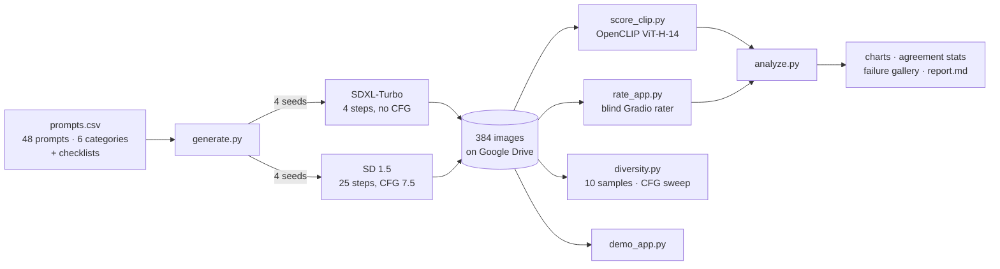

# Mini-DrawBench: Who Grades the Imagination?

An independent text-to-image benchmark built for the MSAI-630 residency hackathon (Project 2). It uses 48 stress-test prompts, two open models, and two judges, CLIP and blind human raters. The main question is where those two judges disagree.

## Results

_Fill this in from `data/results/report.md` after running the analysis._

| | SDXL-Turbo | SD 1.5 |
|---|---|---|
| Human pass rate (all checklist items) | | |
| Mean CLIPScore | | |

- Spearman ρ, CLIP vs. human score:
- Within-prompt concordance:
- Inter-rater reliability (Krippendorff α):

## Architecture



Everything runs on a single free Colab T4. There are no paid APIs and no keys, so there's nothing external that can break during the demo.

| Model | Year | Text encoder(s) | Sampling | Why it's here |
|---|---|---|---|---|
| SD 1.5 | 2022 | OpenAI CLIP ViT-L/14 | 25 steps, classifier-free guidance (CFG) 7.5 | Plain latent diffusion baseline |
| SDXL-Turbo | 2023 | CLIP ViT-L + OpenCLIP ViT-bigG | 4 steps, no CFG | Bigger model, distilled with an adversarial loss |

## Setup

**Colab (recommended).** Open `notebooks/Mini_DrawBench_Colab.ipynb`, set the runtime to T4 GPU, put your repo URL in cell 1, and run the cells top to bottom. Data is saved to Google Drive, so any step can be re-run after a disconnect.

**Local (needs a CUDA GPU with at least 12 GB):**

```bash
pip install -r requirements.txt
python generate.py                 # 384 images -> data/images/
python score_clip.py               # -> data/clip_scores.csv
python rate_app.py --share         # blind human ratings -> data/ratings.csv
python analyze.py                  # -> data/results/
python diversity.py                # stretch goal
python diversity.py --models sd15 --guidance 2 5 7.5 12
python demo_app.py --share         # demo day
```

Set `MDB_DATA` to put data somewhere other than `./data`.

## Evaluation set (`prompts.csv`)

There are 6 categories with 8 prompts each. Every prompt has a checklist of facts a rater can verify by looking at the image. We wrote the prompts before generating any images.

| Category | What it stresses | Example |
|---|---|---|
| Counting | Exact object counts | "A birthday cake with seven lit candles" |
| Spatial | Relations: left/right, above/below, inside, behind | "A red ball to the left of a blue box" |
| Color binding | Attaching the right color to the right object, including counter-stereotypes | "A green banana and a red apple in a bowl" |
| Text rendering | Exact spelling of short strings | "A red neon sign spelling 'NOODLES'" |
| Rare words | Uncommon nouns (the checklist describes what they look like) | "A tuatara resting on a rock" |
| Conflicting | Contradictory constraints | "A black-and-white photograph of a bright red rose" |

The benchmark uses 4 fixed seeds (0 to 3) per prompt per model. The diversity test uses seeds 1000 to 1009 instead, so its images never overlap with the main benchmark.

## Metrics

- **CLIPScore** = 100 × max(cos(image, prompt), 0), computed with OpenCLIP ViT-H-14 (LAION-2B). SD 1.5's text encoder is a different CLIP model. SDXL-Turbo uses an OpenCLIP encoder from the same family, which is a caveat we state openly.
- **Human pass rate**: the share of ratings where every checklist item was satisfied. The checklist is strict on purpose. We also record a 1 to 5 overall score.
- **Rater reliability**: Krippendorff's α across all raters, plus Cohen's κ for each pair of raters. If humans don't agree with each other, we can't use them to judge CLIP.
- **CLIP vs. human agreement**:
  - Spearman ρ between CLIPScore and human score.
  - AUC of CLIP predicting a human pass, where 0.5 is no better than a coin flip.
  - Within-prompt concordance: for two images of the same prompt that humans clearly rank differently, how often CLIP ranks them the same way. Comparing within one prompt removes prompt difficulty from the picture.
  - Model-winner agreement: for each prompt, whether CLIP picks the same better model as the humans do.
- **Disagreement cases** (`disagreements.csv`):
  - "CLIP fooled": the image's CLIPScore is in the top quarter for its model, but humans failed it.
  - "CLIP too harsh": the CLIPScore is in the bottom quarter, but humans passed it.
- **Diversity**: mean pairwise cosine distance between image embeddings (DINOv2 and CLIP) across 10 samples of the same prompt. It's reported per model and across an SD 1.5 CFG sweep to show the quality-vs-diversity tradeoff.

## Output files (`data/results/`)

| File | Use |
|---|---|
| `fig1_human_pass_by_category.png` | Main results slide |
| `fig2_clip_by_category.png` | CLIP's view of the same categories (a dot plot, because CLIP scores sit in a narrow band) |
| `fig3_clip_vs_human.png` | One scatter panel per category, with ρ for each |
| `fig4_clip_agreement_by_category.png` | How often CLIP agrees with humans, by category, against the coin-flip line |
| `fig5_failure_gallery.png` | Each model's most embarrassing failures, shown with their CLIPScore |
| `fig6_diversity_by_model.png`, `fig7_cfg_quality_vs_diversity.png` | Stretch goal |
| `report.md` | All headline numbers |

## Ethics and limitations

- **Whose benchmark is it?** Five students wrote 48 English prompts. The set is small and culturally narrow, so we publish it in full and don't claim it's general.
- **CLIP's biases become the benchmark's biases.** That's why human ratings sit next to every CLIP number and are never replaced by it.
- **Family overlap.** SDXL-Turbo uses an OpenCLIP text encoder, and so does our scorer. Shared training data could favor SDXL-Turbo.
- **No real people, logos, or demographic descriptors** appear in the prompts. That avoids likeness and stereotype issues, and it also means the benchmark doesn't test them.
- **Safety filter.** SD 1.5's safety checker is left on. Anything it flags is logged as a refusal and reported separately, not counted as a failure or a pass.
- **Rater effects.** Raters are teammates who know the hypothesis. The blind setup hides which model made each image, but not what we expect to find. We report inter-rater agreement for that reason.

## Team

| Role | Name | Owns |
|---|---|---|
| Product Lead | | Framing, scope, pitch |
| Model/Prompt Engineer | | `prompts.csv`, `generate.py` |
| Integration Engineer | | `rate_app.py`, `demo_app.py`, repo |
| Evaluation Lead | | `score_clip.py`, `analyze.py`, failure log |
| Ethics & Risk Lead | | Ethics slide, second rater |
